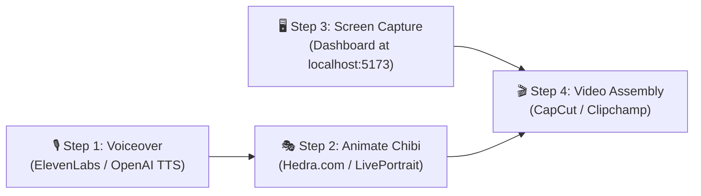

# 🎬 AI-Generated Chibi Video Production Blueprint
**Project:** UK Wind Grid — Day-Ahead Forecasting & Procurement Advisory System  
**Format:** Chibi Animated Character + Screen Recording / Slides  
**Total Target Duration:** 9 to 10 Minutes (Part 1: ~4.5 mins, Part 2: ~4.5 mins)  

---

## 1. The Character: "Volt" (The Chibi Energy Engineer)

### 🎨 Character Concept & Style Guide
* **Style:** High-end 2D Chibi anime aesthetic (Studio Trigger / Genshin Chibi style). Clean line art, expressive oversized eyes, cute proportions, tech-forward energy trader vibe.
* **Appearance:** Dark slate hoodie with electric cyan glowing trims, round glasses, energetic messy hair, holding a glowing holographic tablet or pointer.

---

### 🖼️ Prompts for Image Generation (Midjourney / Flux / DALL-E 3 / Leonardo.ai)

#### Prompt 1: Front-Facing Talking Head (Primary Avatar for Lip-Sync)
> **Prompt:**  
> `Chibi anime software engineer, front-facing portrait, cute big expressive brown eyes with round glasses, stylish dark navy hoodie with glowing cyan energy circuits, slight welcoming smile, vibrant anime aesthetic, clean 2D vector style, cel-shaded, smooth studio lighting, solid neutral dark background, high resolution, 8k, character sheet quality --ar 1:1 --v 6.0`

#### Prompt 2: Full-Body Explaining & Pointing (For Cutaways)
> **Prompt:**  
> `Full-body chibi anime character standing, wearing modern developer sneakers and dark tech hoodie, excitedly pointing with a glowing digital laser pen towards a holographic graph floating in mid-air, dynamic pose, adorable anime proportions, clean sharp lines, studio ghibli inspired vibrant colors, dark slate minimalist background --ar 16:9`

#### Prompt 3: Serious / Analytical Pose (For Error Shortfall Discussion)
> **Prompt:**  
> `Chibi anime tech analyst looking thoughtful, hand on chin, analyzing floating red and amber energy warning icons, holographic wind turbines and electricity graphs floating around, cute serious expression, futuristic data visualization, modern anime art, high detail --ar 16:9`

---

## 2. The 3-Step Free Video Generation Pipeline

### Step 1: Voiceover Generation
* **Tool:** [ElevenLabs.io](https://elevenlabs.io) (Free Tier) or [OpenAI Audio TTS](https://platform.openai.com/docs/guides/text-to-speech)
* **Voice Style:** Young, clear, articulate, professional engineer. (Recommended ElevenLabs voices: *Adam*, *Charlie*, or *Daniel*).
* **Execution:** Copy and paste the script sections below and generate `.mp3` audio files for Part 1 and Part 2.

### Step 2: Talking Chibi Animation
* **Tool:** [Hedra.com](https://www.hedra.com) (Character-1 / Free) or [D-ID](https://www.d-id.com) or [LivePortrait](https://github.com/KwaiVGI/LivePortrait)
* **Execution:** Upload **Prompt 1 (Chibi Portrait)** + the generated voiceover audio file. Hedra will generate a video of the chibi character naturally speaking, blinking, and expressing emotions in sync with the speech!

### Step 3: Screen Recording Dashboard
* Open the live dashboard at `http://localhost:5173`.
* Record a 4-minute screen capture using OBS Studio or Chrome Screen Recorder:
  * Select date `2026-01-02`.
  * Hover over the **MAE KPI Card** and **Backup Power Required (79,004 MWh)**.
  * Hover along the **Actual vs. Forecast** curves.
  * Scroll down to the **Settlement Period Breakdown Table**.
  * Flip to VS Code showing the project directory and Dockerfile for Part 2.

### Step 4: Final Montage (CapCut or Clipchamp)
* Place the screen capture on the main video track.
* Place the animated Chibi talking video in the **bottom-right or top-left corner as a Picture-in-Picture (PiP) badge** with a glowing cyan rounded frame.
* Cut to full-screen Chibi during the Intro (0:00) and Outro (9:15).

---

## 3. The Full 10-Minute Word-for-Word Script

---

### 🇬🇧 PART 1: CLIENT PITCH & PILOT DEMO (0:00 – 4:45)
**Persona:** Product Consultant & Lead Energy Solution Engineer  
**Client Audience:** UK Electricity Utility — Day-Ahead Wholesale Power Trading Desk  
**Goal:** Deliver an impressive, commercially compelling demo of the January 2026 pilot outturn.

---

#### Scene 1: The High-Stakes Balancing Problem (0:00 – 1:15)
* **Visual:** Full-screen Chibi greeting the audience, transitioning to a split screen with a wind turbine icon and a UK national grid map.
* **Chibi Voiceover:**  
  > *"Good morning, everyone! Welcome to our pilot demonstration of the **UK Wind Day-Ahead Forecasting and Procurement Advisory Portal**.*
  >
  > *As a major UK electricity utility, your daily mandate is clear: keep the lights on for millions of consumers at the lowest possible wholesale procurement cost. But as the UK grid rapidly transitions toward renewable energy, your single greatest operational headache is **wind intermittency**.*
  >
  > *In the UK wholesale day-ahead market, gate closure happens at **12:00 PM noon on day D minus one**. Once that gate closes, your bids for tomorrow's power delivery are locked in. If your weather forecasts overestimate wind generation, you are left with an unserved power deficit that forces you into emergency balancing mechanism dispatch—procuring expensive gas-fired CCGT power at severe penalty pricing.*
  >
  > *Our platform was specifically commissioned as a pilot to solve this exact problem: to give your trading desk real-time visibility into the latest pre-gate forecasts, and more importantly, to **quantify forecast risk** before a single pound sterling is committed."*

---

#### Scene 2: Live Portal Walkthrough & Key Metrics (1:15 – 2:30)
* **Visual:** Chibi in the bottom-right corner badge. Screen zooms into the top dashboard header and the 4 KPI cards for **January 2, 2026**.
* **Chibi Voiceover:**  
  > *"Let's look at the live platform. For our pilot evaluation, we ingested official national-level generation data from **Elexon BMRS** across **January 2026**.*
  >
  > *Notice the top bar: here, your traders can select any target delivery date. Today, let’s examine **January 2nd, 2026**.*
  >
  > *Immediately, the portal presents four executive KPI cards:*
  > * *First: **Mean Absolute Error (MAE)** of **3,291.8 Megawatts**. This tells your desk that across the 24 hours of delivery, the average hourly variance was over 3.2 Gigawatts.*
  > * *Second: **Forecast Bias (Mean Bias Error)** of **negative 3,291.8 Megawatts**. This directional indicator reveals a dangerous trend: the weather models suffered from massive, systematic over-forecasting.*
  > * *Third, and most critical for your bottom line: **Backup Power Required**. On this single day, the cumulative unserved energy totaled **79,004 Megawatt-hours**.*
  > * *And fourth: **Total Delivery Outturn**, showing that while 433,000 MWh was forecasted, only 354,000 MWh actually materialized on the grid."*

---

#### Scene 3: Hourly Dispatch Analysis & The Shortfall Delta (2:30 – 3:45)
* **Visual:** Screen moves to the interactive **Forecast vs. Actual MW Area Chart**, with Chibi pointing to the gap between the cyan line and green line.
* **Chibi Voiceover:**  
  > *"Now, let's dive into the hourly dynamics. On our main time-series chart, the cyan line represents the latest wind forecast available prior to the 12:00 PM day-ahead gate closure, while the solid green line represents actual FUELHH outturn across all 48 settlement periods.*
  >
  > *Look at peak evening demand between **18:00 and 22:00 UTC**. The weather models predicted sustained high wind generation of nearly **18,400 Megawatts**. In reality, actual wind plummeted to **14,200 Megawatts**—creating a sustained 4,000 MW generation deficit during the most expensive hours of the day!*
  >
  > *Our secondary chart below isolates this exact delta: every single bar is deep in the amber shortfall zone. Without quantitative foresight, your trading desk would have been completely blindsided by this shortfall."*

---

#### Scene 4: Commercial Value & Automated Trading Advisory (3:45 – 4:45)
* **Visual:** Highlight zooms into the dynamic **Procurement Advisory Banner** on the dashboard.
* **Chibi Voiceover:**  
  > *"This brings us to the centerpiece of our platform: the **Automated Trading Advisory Engine**.*
  >
  > *Instead of leaving your desk to manually calculate error spreads, our engine analyzes historical model bias and issues immediate, actionable procurement guidance. For January 2nd, the advisory advises your power traders: **apply a 15% negative risk buffer to raw wind bids, and pre-procure flexible CCGT thermal reserves during the day-ahead auction**, where power is significantly cheaper than late balancing mechanism penalties.*
  >
  > *In summary, this pilot delivers three measurable business outcomes: it eliminates unexpected imbalance penalties, optimizes thermal reserve procurement, and gives your trading team a quantitative edge in the wholesale day-ahead market. Thank you, and we look forward to rolling this out into full production for your team!"*

---

### 💻 PART 2: TECHNICAL ARCHITECTURE & CODE REVIEW (4:45 – 9:30)
**Persona:** Senior Full-Stack Software Engineer & Solutions Architect  
**Audience:** Internal Technical Lead & Engineering Review Board  
**Goal:** Deliver a rigorous, transparent walkthrough of system architecture, API streaming, temporal gate closure logic, caching strategy, and Docker deployment.

---

#### Scene 5: High-Level Architecture Overview (4:45 – 5:45)
* **Visual:** Chibi returns full-screen briefly, then switches to the architectural diagram from `README.md`.
* **Chibi Voiceover:**  
  > *"Welcome to part two of our presentation. I'm now going to walk through the technical architecture, design patterns, and codebase for our internal engineering review.*
  >
  > *The system is engineered as a decoupled, cloud-ready full-stack application:*
  > * *The **Frontend** is built with **React 19**, **Vite**, and **TailwindCSS**, utilizing **Recharts** for high-performance SVG/Canvas data visualization.*
  > * *The **Backend** is powered by **Python** and **FastAPI**, chosen for its native asynchronous request handling, Pydantic type validation, and automatic OpenAPI schema generation.*
  > * *The entire solution is fully containerized using **Docker** and **Docker Compose**, with production-ready builds configured for Vercel and Render."*

---

#### Scene 6: Elexon BMRS API Pipeline (`elexon_client.py`) (5:45 – 6:45)
* **Visual:** Screen shows `backend/app/elexon_client.py` in VS Code with syntax highlighting.
* **Chibi Voiceover:**  
  > *"Let's inspect how we interface with the upstream data provider. We consume official Great Britain balancing mechanism data directly from **Elexon Insights API** using two primary streaming endpoints:*
  >
  > *1. First, **`/datasets/FUELHH/stream`**: This delivers half-hourly generation outturn aggregated by fuel type. We filter specifically for `fuelType=WIND` and pass target `settlementDate` query parameters.*
  > *2. Second, **`/datasets/WINDFOR/stream`**: This provides wind generation forecasts. Crucially, each record includes both a `publishTime` (when the forecast was generated) and a `startTime` (the target settlement period).*
  >
  > *Both endpoints are encapsulated inside our asynchronous `ElexonClient` class using `httpx.AsyncClient` with resilient 45-second timeout thresholds and connection pooling."*

---

#### Scene 7: Day-Ahead Gate Closure & Alignment Logic (`processing.py`) (6:45 – 8:00)
* **Visual:** Screen zooms into `backend/app/processing.py`, highlighting the `get_gate_closure` method and forecast filtering loop.
* **Chibi Voiceover:**  
  > *"Now, let's examine the core domain logic: **enforcing the Day-Ahead Market Gate Closure**.*
  >
  > *In the UK EPEX SPOT and Nord Pool auctions, day-ahead gate closure occurs strictly at **12:00 PM UTC on day D minus one**. Therefore, a forecast generated at 3:00 PM on D-1 is completely irrelevant to a day-ahead procurement decision—because that decision had to be finalized 3 hours earlier!*
  >
  > *Our `DataProcessor` strictly enforces this temporal boundary. For any delivery date $D$, it computes the exact gate closure timestamp:*
  > $$T_{\text{gate}} = (D - 1\text{ day}) \text{ at } 12:00\text{ UTC}$$
  > *We then query all forecasts published up to $T_{\text{gate}}$ and execute an $O(n)$ sliding deduplication to extract the **latest published forecast** for each of the 24 hourly periods.*
  >
  > *Simultaneously, we aggregate the 48 half-hour settlement periods from `FUELHH` into matching 1-hour outturn blocks, computing instantaneous delta, Mean Absolute Error, Root Mean Squared Error, and cumulative unserved MWh shortfall."*

---

#### Scene 8: Caching Layer & Production Resilience (`cache.py`) (8:00 – 8:50)
* **Visual:** Screen shows `backend/app/cache.py` showing SQLite connection and schema.
* **Chibi Voiceover:**  
  > *"To ensure resilience and sub-10-millisecond response times, we built a dedicated **SQLite caching layer** in `cache.py`.*
  >
  > *Upstream public government APIs can experience rate limits or latency spikes. When our backend fetches settlement or forecast streams, the raw payload is serialized and indexed in a local SQLite database with timestamps.*
  >
  > *Any subsequent request for that date is served instantaneously from the local cache. If the external Elexon network is temporarily down, our application continues to serve previously cached historical dates without degradation."*

---

#### Scene 9: Dockerization, Deployment & Conclusion (8:50 – 9:45)
* **Visual:** Screen displays `docker-compose.yml`, `backend/Dockerfile`, and `frontend/Dockerfile`.
* **Chibi Voiceover:**  
  > *"Finally, let’s look at containerization and deployment.*
  >
  > *In `docker-compose.yml`, we define a multi-container network. The backend uses a slim Python 3.11 image binding dynamically to `$PORT`, while the frontend uses a multi-stage Docker build—compiling React assets via Vite and serving them via a high-performance **Nginx** alpine image.*
  >
  > *For public deployment, our repository is ready for immediate deployment on **Vercel** for the client UI and **Render** for the API.*
  >
  > *In compliance with the challenge submission guidelines, all code has been committed to our anonymous public GitHub repository, complete with comprehensive API documentation, mathematical formulas, and full AI attribution.*
  >
  > *Thank you for your time and review. I welcome any questions or architectural feedback!"*

---

## 4. Summary Checklist for Submitting

- [ ] Generate the voiceover mp3s via ElevenLabs using this script.
- [ ] Run the chibi portrait through Hedra.com to produce the talking head video.
- [ ] Record 4 minutes of the live dashboard at `localhost:5173`.
- [ ] Combine in CapCut / Clipchamp (Picture-in-Picture mode) and export as a 1080p MP4.
- [ ] Upload to YouTube as **Unlisted**.
- [ ] Paste the YouTube link and GitHub repo URL ([volt-l18/reint-wind-grid-7f9](https://github.com/volt-l18/reint-wind-grid-7f9)) into the Reint AI Google Form!
